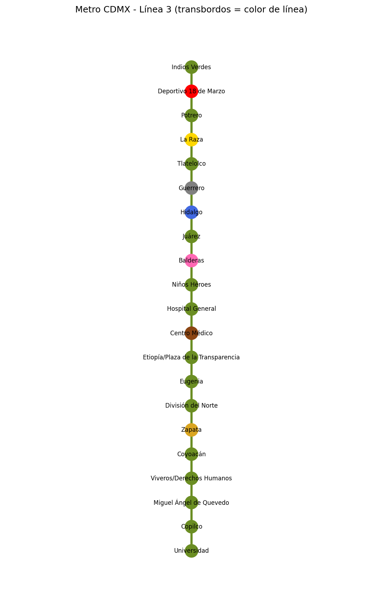
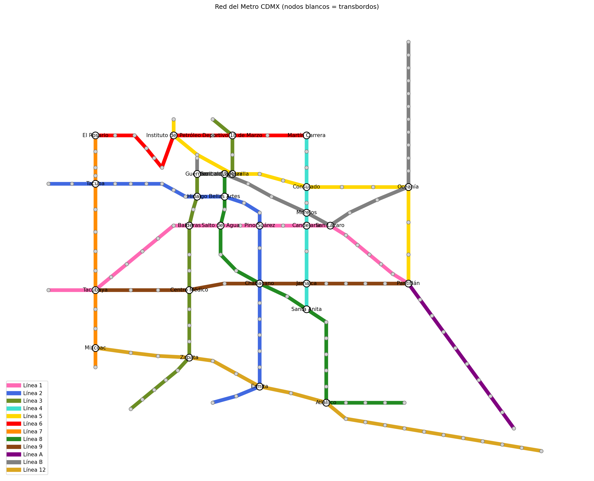

# Modelos del Metro de la Ciudad de México con NetworkX

Este repositorio contiene dos programas en Python que representan la red del Metro CDMX mediante grafos.

## Archivos

- `linea3_metro.py`: representa la Línea 3, desde Indios Verdes hasta Universidad.
- `red_metro_cdmx.py`: representa las 12 líneas del Metro como una sola red. Las estaciones compartidas se representan como nodos de transbordo.
- `requirements.txt`: bibliotecas necesarias.

## Conceptos utilizados

- **Nodo:** representa una estación.
- **Arista:** representa la conexión entre dos estaciones consecutivas.
- **Grafo no dirigido:** permite representar el recorrido en ambos sentidos.
- **Atributos:** almacenan información adicional de las estaciones y conexiones.
- **Grado:** indica cuántas conexiones directas tiene una estación.

## Instalación
Se recomienda utilizar Python 3.10 o posterior.

## Ejecución

Para ejecutar el modelo de la Línea 3:

```bash
python linea3_metro.py
```

Para ejecutar el modelo de toda la red:

```bash
python red_metro_cdmx.py
```
## Grafo de la Línea 3



## Red completa del Metro CDMX



Cada programa muestra información del grafo y genera una visualización. Las imágenes se guardan en la misma carpeta donde se ejecuta el programa.

## Nota
Las coordenadas y los colores de la visualización son aproximados y se utilizan para representar gráficamente la distribución de las estaciones. No es un sistema oficial de navegación ni de información en tiempo real.

## Uso de inteligencia artificial
La IA ayudó a organizar y depurar el código, ajustar las coordenadas y los estilos de las gráficas, y revisar posibles inconsistencias en las estructuras de datos.
